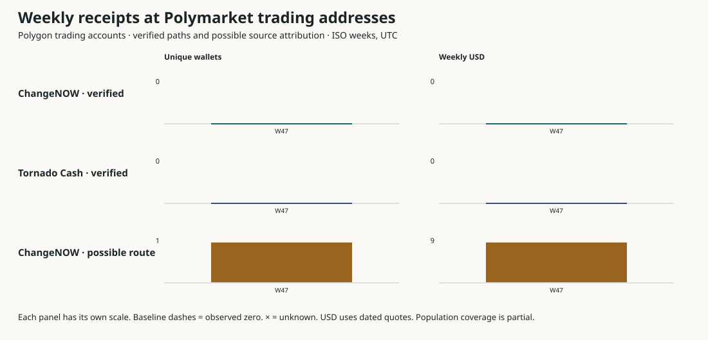

# Weekly funding intelligence

Offline snapshot for **2026-W47 through 2026-W47**, ISO weeks in UTC. A case is a distinct Polygon trading address that received a documented credit. Weekly USD values price the final credited leg at the latest eligible daily quote. Global platform totals are **UNKNOWN**.

The last 1 weeks contain **0 distinct ChangeNOW-funded accounts** and **0 distinct Tornado Cash-funded accounts** at the two accepted evidence levels. The table also gives the transfer value from the commingled route to exact trading addresses. A match there remains POSSIBLE.

Across that window the possible route supplied **1 transfers to 1 distinct trading addresses, worth USD 8.93**. 1 of these addresses executed a later trade within the observation window.

## Eight latest closed weeks

| ISO week | ChangeNOW verified wallets | USD | Tornado verified wallets | USD | Possible ChangeNOW route, exact PM wallets | Possible USD | Verified intersection | Active PM addresses sampled |
|---|---:|---:|---:|---:|---:|---:|---:|---:|
| 2026-W47 | 0 | 0.00 | 0 | 0.00 | 1 | 8.93 | 0 | 856 |

## Full chronological ledger

Recipients count observed chain/address pairs. ChangeNOW intake includes its separately classified commingled route and internal destinations. Direct and indirect columns count verified PM trading accounts only. New means first observed since the start of this snapshot. The change column compares observed funded accounts only where the source-window definitions match. Each rate uses the intersection with the independent same-week active sample.

| Week | Service | Labelled/pool recipients | Mixed-route recipients | Exact PM recipients | Direct | Indirect | New | Traded later | Funding USD | ≥ $1k | ≥ $10k | Change | Funded in sample / sample | Unassigned recipients |
|---|---|---:|---:|---:|---:|---:|---:|---:|---:|---:|---:|---:|---|---:|
| 2026-W47 | ChangeNOW | 0 | 1514 | 1 | 0 | 0 | 0 | 0 | 0.00 | 0 | 0 | 0 | 0 / 856 | 1511 |
| 2026-W47 | Tornado Cash | 673 | 0 | 0 | 0 | 0 | 0 | 0 | 0.00 | 0 | 0 | 0 | 0 / 856 | 673 |

## Coverage and interpretation

- Polygon covers three allowlisted stablecoin Transfer streams from two labelled hot wallets, one consolidation address and the commingled f2020 rail, plus Withdrawal logs from four registered native pools. Ethereum covers two tagged hot wallets on USDC/USDT/DAI and six classic pools during the captured Ethereum log weeks. The existing native Ethereum explorer archive covers three tagged sources during its own time window. Every week and stream has an explicit status and block range in the JSON.
- The independent denominator uses order owners observed in three predetermined eight-block windows on Polygon per week. Positive account enrichment uses an exact executed trade, documented historic accounts, and deterministic searches described in the README. Missing activity, same-hex Ethereum receipts and signer-only associations have their own classifications. A wallet address identifies an endpoint. Custody, control of the initial Tornado deposit, and who paid for a bet are separate questions.
- An observed zero describes the searched sources and paths. The all-chain, whole-platform funding count, first-ever status, uncovered native/internal transfers, unregistered pools and general bridge attribution remain UNKNOWN. The current open week is outside this closed-week snapshot. Weekly differences also reflect sample composition, price coverage and left/right censoring.
- USD for a proven native forward is the conservative lower bound after fees. The CSV keeps the receipt units and valuation timestamp. One transfer can finance several later trades or none. Per-wallet economic PnL is an API observation with its own timestamp. It never determines membership or service attribution.

| Source stream | Fully bracketed weeks | Partial or archive-only weeks | No captured week |
|---|---:|---|---|
| 137/changenow | 2026-W47 | — | — |
| 137/tornado | 2026-W47 | — | — |
| 1/changenow | 2026-W47 | — | — |
| 1/tornado | 2026-W47 | — | — |
| 1/changenow_native_archive | — | — | 2026-W47 |

## Indirect paths

The archived f2020 sweep has 3,408 distinct payees, 158 bettor records and 153 distinct lowercased trading addresses. Its lifetime totals cannot be allocated to individual weeks from that sweep alone.

The native EOA screen covered 13 Polygon withdrawal recipients in 2026-W47–2026-W47. It examined 9 simple onward-payment candidates. 9 had no indexed trade at the terminal. 0 address histories hit the page cap and 0 lookups were unavailable. A successful proof requires the sender's nonce, code, receipt, fee and ending balance.

The stablecoin screen queried 46 documented signer/proxy pairs and found 0 temporally eligible same-asset forwards. The balance and complete intervening token ledger decide which can be counted. The archive supplied 59 distinct Relay origin transactions to compare by chain and hash. 0 matched and require two-leg verification before admission.

## Statistical results

| Endpoint | ChangeNOW | Tornado Cash | Required observations |
|---|---|---|---|
| concentration | NOT_TESTABLE (0 pairs) | NOT_TESTABLE (0 pairs) | Fewer than 20 independent matched pairs with known funding size, age, prior volume, liquidity and 7-day market buy notionals |
| pre_move | NOT_TESTABLE (0 pairs) | NOT_TESTABLE (0 pairs) | Fewer than 20 independent matched pairs with known funding size, age, prior volume, liquidity and pre-trade midpoint and 6-hour price paths |
| coordination | NOT_TESTABLE (0 pairs) | NOT_TESTABLE (0 pairs) | Fewer than 20 independent matched pairs with known funding size, age, prior volume, liquidity and signed exposure and contemporaneous peer exposure |
| holdout_return | NOT_TESTABLE (0 pairs) | NOT_TESTABLE (0 pairs) | Fewer than 20 independent matched pairs with known funding size, age, prior volume, liquidity and 30-day cash flows, fees and executable inventory marks |
| incremental_brier | NOT_TESTABLE (0 pairs) | NOT_TESTABLE (0 pairs) | Fewer than 20 independent matched pairs with known funding size, age, prior volume, liquidity and held-out outcomes and frozen causal price/large-bet probability forecasts |

The frozen plan specifies ten comparisons, holdout purging and Holm adjustment. A NOT_TESTABLE endpoint has no observed p-value.

[Weekly CSV](weekly_funding.csv) · [Wallet ledger](wallet_funding.csv) · [Coverage, sets, input hashes and statistics](weekly_funding.json) · [Method, scope and reproduction](../README.md) · [Audit](../AUDIT.md) · [Frozen protocol](../PROTOCOL.md)
